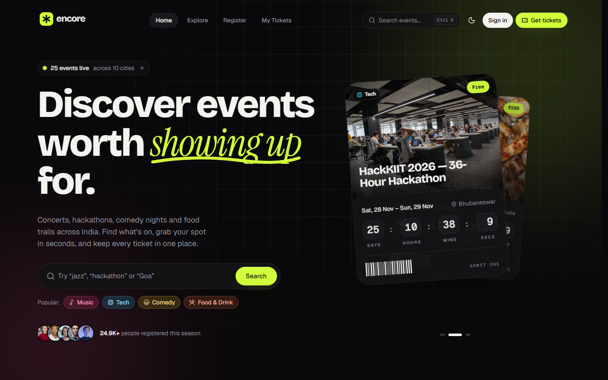
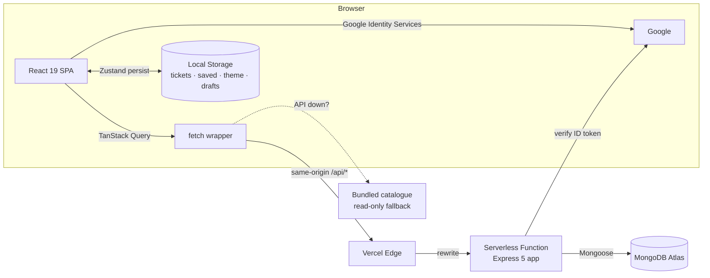
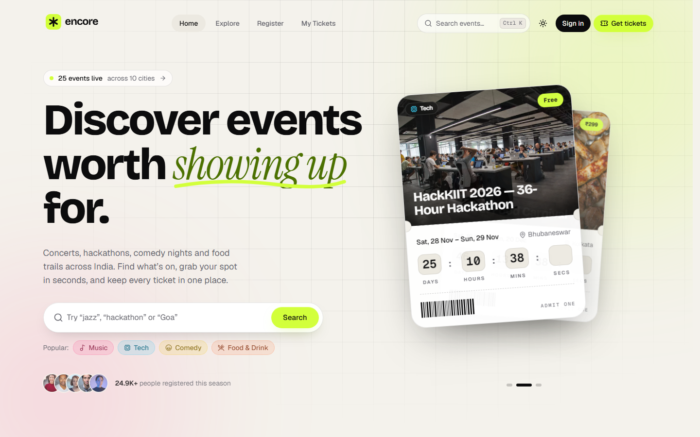
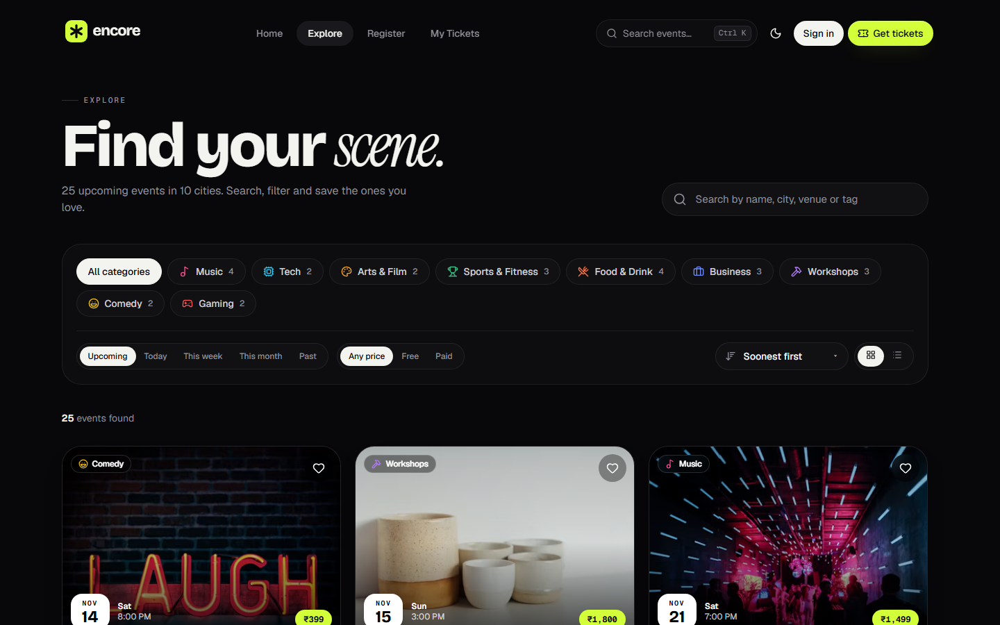
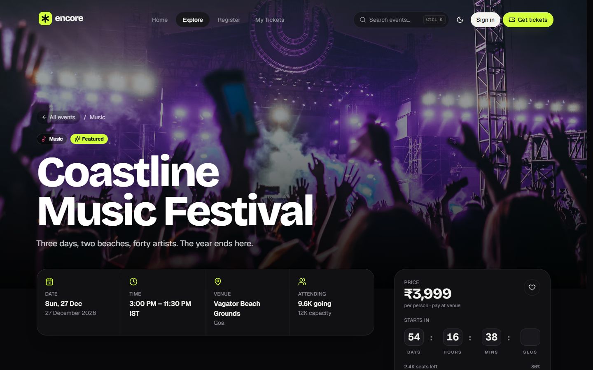
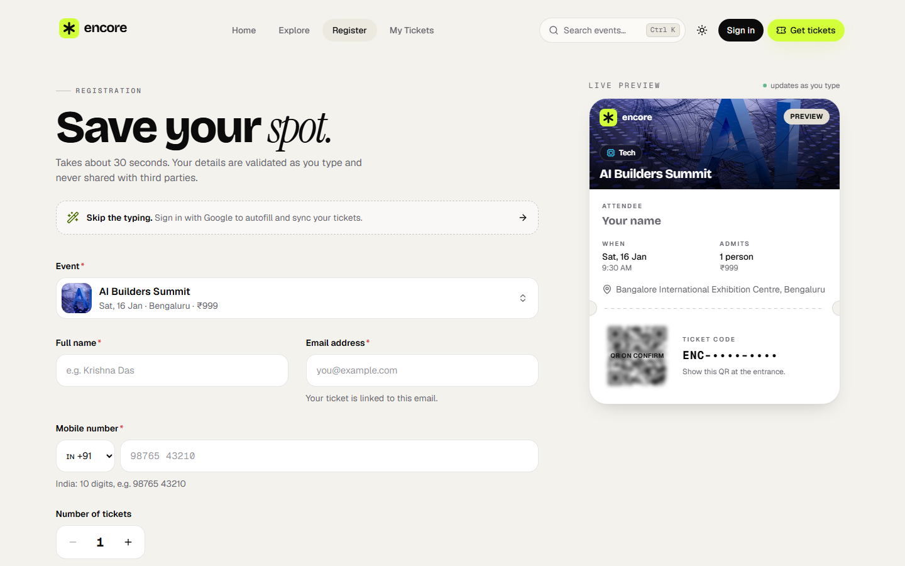
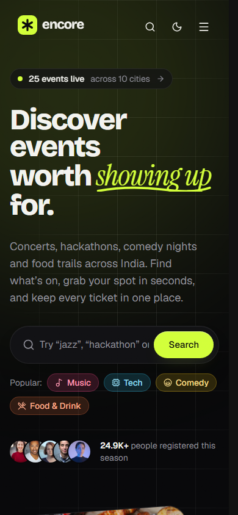
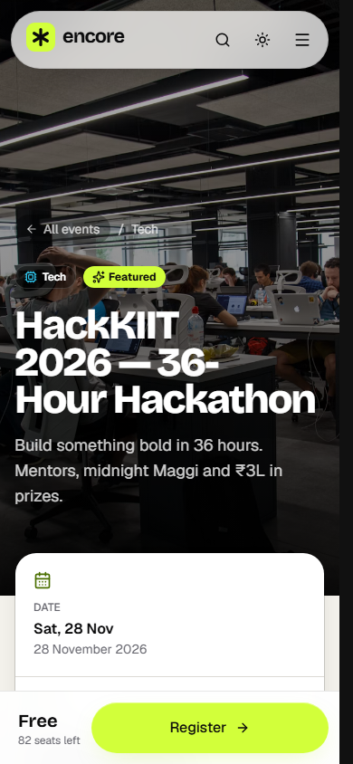
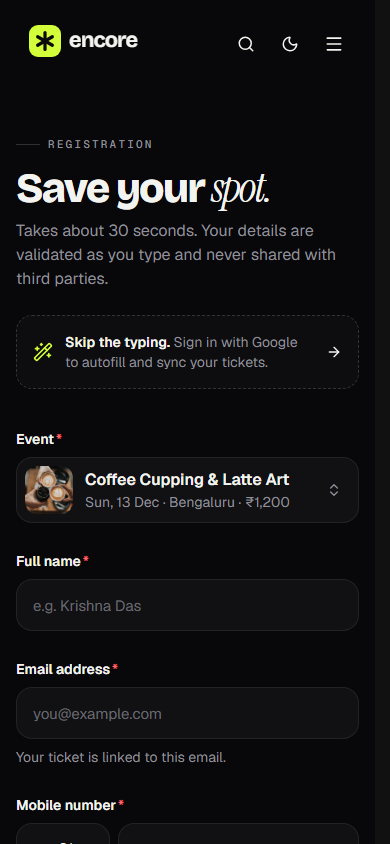

<div align="center">


# Encore — events worth showing up for

**A modern, full-stack event discovery & registration platform**
built for the **K Explore — Web Designing** task.

[**🌐 Live site → encore-kexplore.vercel.app**](https://encore-kexplore.vercel.app) &nbsp;·&nbsp; [API on Render](https://encore-api-ycyn.onrender.com/api/health) &nbsp;·&nbsp; [Source](https://github.com/Krishna-Das20/Event-Management-KEXPLORE)




</div>

---

## Table of contents

1. [The brief → what was built](#the-brief--what-was-built)
2. [Bonus challenges](#bonus-challenges)
3. [Feature tour](#feature-tour)
4. [Tech stack](#tech-stack)
5. [Architecture](#architecture)
6. [Form validation](#form-validation)
7. [Local Storage data management](#local-storage-data-management)
8. [REST API](#rest-api)
9. [Project structure](#project-structure)
10. [Run it locally](#run-it-locally)
11. [Deployment](#deployment)
12. [Accessibility, performance & security](#accessibility-performance--security)
13. [Screenshots](#screenshots)

---

## The brief → what was built

| Requirement from the problem statement | How Encore delivers it |
| --- | --- |
| Attractive **hero section** introducing the platform | Animated, kinetic headline with a hand-drawn underline, live event counter, instant search, and a **3D tilting deck of featured tickets** that shuffles itself and reacts to the cursor. |
| **Upcoming & featured events** section | “The headliners” bento grid (featured events with live countdowns) + a “Coming up next” grid with category tabs. |
| Event **cards** with name, date, venue, image, short description | Ticket-shaped cards with punched perforations, date block, venue, tagline, price, seats-left meter, live countdown and a save button. |
| **Browse, search, and filter by category** | `/events` — debounced search (name, city, venue, tag), multi-select category chips with counts, date range (today / week / month / past), price (free / paid), 5 sort orders, grid ⇄ list view, infinite scroll. All filters live in the URL, so results are shareable. |
| **Event details** with a registration option | `/events/:slug` — cinematic parallax hero, key facts, about, highlights, schedule timeline, lineup, gallery, interactive map, organiser, FAQs, related events, and a sticky ticket panel with **Register**, **Add to calendar** and **Share**. |
| Registration form: **name, email, phone, selected event** | `/register` — searchable event picker (with thumbnails), name, email, country-aware mobile number, ticket count and consent. |
| **JavaScript form validation** | Real-time validation with clear inline messages, focus on the first error, typo detection (“did you mean gmail.com?”), country-specific phone rules — and the **same rules enforced again on the server**. See [Form validation](#form-validation). |
| **Confirmation message** on success | Confetti 🎉, a personalised “You’re in!” screen, booking summary, and a real **QR-code ticket** you can download as PNG or add to your calendar. |
| **Responsive** on phones, tablets and desktops | Mobile-first layouts tested at 375 px → 1440 px+; full-screen mobile menu, sticky mobile “Register” bar, horizontally scrollable filters. |
| Good **UI/UX**, consistent styling, **smooth transitions**, interactive elements | A tokenised design system (light + dark), Motion-powered micro-interactions, smooth scrolling, skeleton loaders, toasts, command palette, and empty/error states everywhere. |
| HTML5, CSS3, JavaScript (+ optional **Tailwind CSS / React.js**) | Semantic HTML5, modern CSS (custom properties, masks, `color-mix`, View Transitions), JavaScript (ES2023), **React 19** and **Tailwind CSS 4**. |
| **Git & GitHub**, README, deployment | This repository, CI on GitHub Actions, and a production deployment on **Vercel**. |

## Bonus challenges

| Bonus | Implementation |
| --- | --- |
| 🌗 **Dark / light mode** | Follows the OS preference by default, remembers your choice in Local Storage, applied before first paint (no flash), and switches with a **circular reveal** animation using the View Transitions API. |
| ⏳ **Event countdown timers** | Live “rolling digit” countdowns on cards, the hero ticket deck, the bento grid, the detail page and in My Tickets. They pause when the tab is hidden and switch to *Happening now* / *Ended* automatically. |
| ✨ **Animations** | Staggered scroll reveals, word-by-word headline reveal, SVG path drawing, 3D tilt + spring physics, shared-layout tab indicators, animated filtering, infinite marquees, cursor spotlights, confetti, Lenis smooth scrolling — all respecting `prefers-reduced-motion`. |
| 💾 **Local Storage registration management** | A full **ticket wallet** stored in Local Storage: works offline and without an account, queues registrations made while offline and syncs them automatically, merges with your Google account when you sign in, and lets you **export (JSON / CSV), import, and clear** your data. See [Local Storage data management](#local-storage-data-management). |

### Beyond the brief

- **MongoDB Atlas** database with an Express 5 REST API (atomic seat reservation, duplicate protection, rate limiting).
- **Sign in with Google** (Google Identity Services: popup button, One Tap, and a full-page redirect flow for phones, in-app browsers and blocked popups) with secure http-only session cookies; tickets booked as a guest are claimed automatically when you sign in.
- **QR-code tickets** and a public **`/verify/:code` door-check page** (personal details masked).
- **⌘K / Ctrl K command palette** with live event search, recently viewed events, categories, pages and actions.
- **Saved events** (wishlist) and **recently viewed** history.
- **Add to calendar** (Google Calendar link or a standards-compliant `.ics` file with a 2-hour reminder) and **native share** (Web Share API with clipboard fallback).
- **Graceful degradation**: if the API or database is unreachable, pages keep working from a bundled snapshot of the catalogue and new registrations are queued and synced later.

## Feature tour

| Page | Highlights |
| --- | --- |
| **Home** `/` | Hero with 3D ticket deck · category marquee · featured bento · upcoming grid with tabs · animated stats · category tiles · how it works · testimonial marquees · call to action |
| **Explore** `/events` | URL-synced search & filters · category counts · date / price / sort · grid & list views · animated layout · infinite scroll · skeletons · empty & error states |
| **Event** `/events/:slug` | Parallax hero · facts · schedule timeline · lineup · gallery · OpenStreetMap embed (dark-mode aware) · FAQ accordion · sticky ticket panel · related events |
| **Register** `/register` | Event combobox · live **ticket preview** that updates as you type · inline validation · autosaved contact details · duplicate warning · confetti + QR ticket on success |
| **My Tickets** `/tickets` | Next-event countdown · upcoming / past / cancelled / saved tabs · sync status per ticket · QR ticket dialog · PNG download · cancel · Local Storage tools |
| **Verify** `/verify/:code` | Door-check page a ticket’s QR code points to — shows whether the ticket is valid |

## Tech stack

**Front end** — React 19 · React Router 7 (data router, lazy routes) · Tailwind CSS 4 · Motion · TanStack Query 5 · Zustand (+ `persist`) · React Hook Form + Zod · Radix UI primitives · cmdk · Lenis · Sonner · `qrcode.react` · `html-to-image` · `canvas-confetti` · Lucide icons · Fontsource (Bricolage Grotesque, Geist, Geist Mono, Instrument Serif)

**Back end** — Node.js · Express 5 · Mongoose 8 / MongoDB Atlas · Zod · `google-auth-library` · JSON Web Tokens · Helmet · CORS · express-rate-limit · compression

**Tooling & hosting** — Vite 7 · ESLint 9 · npm workspaces · GitHub Actions (CI + keep-warm) · Vercel (static site + Serverless Function in Singapore) · Render (standalone API, Singapore) · MongoDB Atlas (Singapore)

## Architecture



- **One repository, two workspaces.** `client/` is the React app, `server/` is a standard Express app. The same API code is deployed twice:
  - **Vercel** — mounted as a Serverless Function (`api/index.js`) behind the website's own `/api/*` route. The site uses this one: no cold starts and first-party cookies.
  - **Render** — a standalone, long-running Node service at [`encore-api-ycyn.onrender.com`](https://encore-api-ycyn.onrender.com/api/health), defined by [`render.yaml`](render.yaml) and kept warm by a scheduled GitHub Action. To route the website through Render instead, point the `/api/(.*)` rewrite in `vercel.json` at `https://encore-api-ycyn.onrender.com/api/$1`.
- **Same-origin API.** The browser always calls `/api/*` (Vite proxies it in development, Vercel rewrites it in production), so the session cookie is first-party — no third-party-cookie problems, no CORS preflights.
- **Serverless-friendly database access.** The Mongo connection is cached across warm invocations, and the demo catalogue is seeded automatically the first time the database is empty.

## Form validation

Validation runs **in the browser as you type** (React Hook Form + Zod) and **again on the server** (Zod), so the UI is instant and the API stays the source of truth.

| Field | Rules | Example message |
| --- | --- | --- |
| Event | Required; must be an upcoming event with seats left (sold-out events are disabled) | “Please choose an event to attend” |
| Full name | 2–60 characters; letters, spaces, `.` `'` `-` only | “Use letters only — no numbers or symbols” |
| Email | Valid format; common domain typos detected with edit distance | “Did you mean **name@gmail.com**? Use it” |
| Mobile | Country-specific length & prefix (🇮🇳 10 digits starting 6–9, 🇺🇸, 🇬🇧, 🇦🇪, 🇸🇬, 🇦🇺); auto-formatted while typing | “Indian mobile numbers start with 6, 7, 8 or 9” |
| Tickets | Integer 1–5, and never more than the seats left | “Only 3 seats left” |
| Consent | Must be checked | “Please accept the event guidelines to continue” |
| Server-only | One active registration per email per event (database unique index); seats reserved atomically | “This email is already registered for this event.” |

UX details: errors appear on blur and then update live, the first invalid field is focused on submit, invalid fields gently shake, valid fields get a check mark, and every message is announced to screen readers (`role="alert"`, `aria-invalid`, `aria-describedby`).

## Local Storage data management

| Key | What it stores |
| --- | --- |
| `encore.tickets` | The ticket wallet — every registration made on this device (and, when signed in, your account’s tickets), each with its event snapshot, status and sync state |
| `encore.library` | Saved events (wishlist) and recently viewed events |
| `encore.contact` | Your contact details, so the registration form fills itself next time (with a one-click *forget*) |
| `encore.theme` | `light` or `dark` |
| `encore.view` | Grid or list view on the Explore page |
| `encore.newsletter` | Remembers that you’ve subscribed |

How the wallet behaves:

1. **Register** → the confirmed ticket is saved to the wallet instantly, so *My Tickets* works offline and without an account.
2. **Offline or server down?** → the registration is stored as **pending** and retried automatically when you’re back online (and every minute), then swapped for the confirmed ticket.
3. **Sign in with Google** → tickets from your account are merged in and marked *Confirmed on server*; tickets you booked earlier as a guest with the same email are linked to your account.
4. **Manage your data** → export everything as **JSON** (a backup you can re-import elsewhere) or **CSV** (opens in Excel / Sheets), import a backup (deduplicated), remove individual tickets, or clear the device — with a storage-usage meter.

## REST API

Base URL: `/api`. All responses are JSON; errors look like `{ "error": { "message", "code", "fields?" } }`.

| Method | Endpoint | Description |
| --- | --- | --- |
| `GET` | `/health` | Service & database status |
| `GET` | `/events` | Search & filter: `q`, `category` (comma list), `when` (`upcoming` `today` `week` `month` `past` `all`), `price` (`all` `free` `paid`), `sort` (`date` `popular` `price-asc` `price-desc` `newest`), `featured`, `page`, `limit` |
| `GET` | `/events/meta` | Category counts, cities and headline stats |
| `GET` | `/events/:slug` | Full event details + related events |
| `POST` | `/registrations` | Register (guest or signed in). Validates input, prevents duplicates, reserves seats atomically |
| `GET` | `/registrations/me` | The signed-in user’s registrations 🔒 |
| `GET` | `/registrations/:code` | Verify a ticket (personal details masked) |
| `POST` | `/registrations/:code/cancel` | Cancel — owner session, or the booking email for guests |
| `POST` | `/auth/google` | Exchange a Google ID token for a session cookie (popup / One Tap) |
| `POST` | `/auth/google/redirect` | Google's full-page redirect callback (form post) → session cookie → back to the app |
| `GET` | `/auth/me` | Current user (or `null`) |
| `POST` | `/auth/logout` | End the session |
| `POST` | `/newsletter` | Subscribe to the weekly lineup |

**Data model** — `Event` (slug, title, category, dates, venue + coordinates, price, capacity, registeredCount, agenda, speakers, FAQs…), `Registration` (ticket code, event, user?, name, email, phone, tickets, status) with a partial unique index on *(event, email)* for active bookings, `User` (Google profile) and `Subscriber`.

## Project structure

```text
.
├── api/index.js              # Vercel Serverless Function → mounts the Express app
├── client/                   # React front end (Vite)
│   ├── public/               # favicon, manifest, OG image
│   └── src/
│       ├── components/       # ui · layout · home · events · registration · tickets · auth
│       ├── hooks/            # useCountdown, useDebouncedValue, useSpotlight…
│       ├── lib/              # api client, queries, validation, formatting, calendar, fallback
│       ├── pages/            # Home, Events, EventDetail, Register, MyTickets, Verify, Legal, 404
│       ├── providers/        # theme, smooth scroll, ticket sync
│       └── store/            # Zustand stores (tickets, saved, ui)
├── server/                   # Express API
│   └── src/
│       ├── config/           # env + cached Mongo connection
│       ├── data/             # demo catalogue + idempotent seeder
│       ├── middleware/       # auth, validation, errors
│       ├── models/           # Event, Registration, User, Subscriber
│       ├── routes/           # events, registrations, auth, newsletter
│       └── validators/       # Zod schemas (mirrors the client rules)
├── docs/screenshots/
├── render.yaml               # Render blueprint for the standalone API
└── vercel.json               # build, rewrites, headers, function region
```

## Run it locally

**Prerequisites:** Node.js 20+, a MongoDB connection string (Atlas free tier works) and a Google OAuth *Web* client ID.

```bash
git clone https://github.com/Krishna-Das20/Event-Management-KEXPLORE.git
cd Event-Management-KEXPLORE
npm install
```

Create the two env files from the examples:

```bash
cp server/.env.example server/.env   # MONGODB_URI, JWT_SECRET, GOOGLE_CLIENT_ID
cp client/.env.example client/.env   # VITE_GOOGLE_CLIENT_ID
```

```bash
npm run seed   # optional — the API also seeds an empty database automatically
npm run dev    # API on http://localhost:5000, web app on http://localhost:5173
```

| Script | What it does |
| --- | --- |
| `npm run dev` | Runs the API (with `--watch`) and the Vite dev server together |
| `npm run build` | Production build of the front end |
| `npm run lint` | ESLint |
| `npm run seed` | Upserts the demo catalogue (`-- --fresh` wipes events & registrations first) |

> For Google sign-in to work locally, add `http://localhost:5173` and `http://localhost` to the OAuth client’s **Authorized JavaScript origins**.

## Deployment

| Piece | Where | Notes |
| --- | --- | --- |
| Website + API | **Vercel** — [encore-kexplore.vercel.app](https://encore-kexplore.vercel.app) | Vite builds `client/dist`; `api/index.js` serves the Express app as a Serverless Function in `sin1` (Singapore). Git-connected: every push to `main` deploys. |
| Standalone API | **Render** — [encore-api-ycyn.onrender.com](https://encore-api-ycyn.onrender.com/api/health) | Free web service in Singapore from [`render.yaml`](render.yaml): `npm ci --workspace=server --omit=dev` → `npm start --workspace=server`, health check `/api/health`. Redeploy with **Manual Deploy** in the Render dashboard or `render deploys create <service-id>` (the service was created from the public repo URL, so it has no GitHub webhook). |
| Database | **MongoDB Atlas** M0 (AWS Singapore) | Network Access allows `0.0.0.0/0` because Vercel and Render use dynamic IPs; access is protected by the database user’s credentials. |
| Google sign-in | **Google Cloud** OAuth client (Web) | Authorized JavaScript origins: the Vercel domains + localhost. Authorized redirect URIs: `…/api/auth/google/redirect` for the full-page flow. App published to production. |

Environment variables (set in Vercel and Render; see `server/.env.example` and `client/.env.example`):

| Variable | Used by | Notes |
| --- | --- | --- |
| `MONGODB_URI` | API | Atlas connection string |
| `JWT_SECRET` | API | Long random string for signing session cookies |
| `GOOGLE_CLIENT_ID` | API | Verifies Google ID tokens |
| `CLIENT_URL` | API | Comma-separated origins allowed to call the API cross-site |
| `VITE_GOOGLE_CLIENT_ID` | Front end | Same Google client ID, exposed at build time |
| `NODE_VERSION` | Render | `22` |

If the database is ever unreachable, the website stays usable through its bundled read-only catalogue and queues new registrations until the API recovers.

## Accessibility, performance & security

- **Accessibility** — semantic landmarks, skip link, keyboard-navigable menus/dialogs/comboboxes (Radix), visible focus rings, `aria-live` regions for results and countdowns, reduced-motion support, WCAG-conscious colour tokens in both themes.
- **Performance** — route-level code splitting, vendor chunking, responsive `srcset` images from the Unsplash CDN, lazy loading, self-hosted variable fonts, query caching with `keepPreviousData`, and the fallback catalogue loaded only when needed.
- **Security** — Google ID tokens verified server-side (plus Google’s double-submit CSRF token on the redirect flow), http-only `SameSite=Lax` session cookie, Helmet headers, strict Zod validation on every input, rate limiting on auth/registration, regex-escaped search, atomic seat reservation, and masked personal data on the public verify page. Secrets live only in environment variables (`.env` files are git-ignored).

## Screenshots

| Light mode | Explore |
| --- | --- |
|  |  |
| **Event details** | **Registration with live ticket preview** |
|  |  |

<p align="center">
  
  
  
</p>

---

<div align="center">

Images from [Unsplash](https://unsplash.com). Events are demo content.
Built by **Krishna Das** for **K Explore — Web Designing**.

</div>
